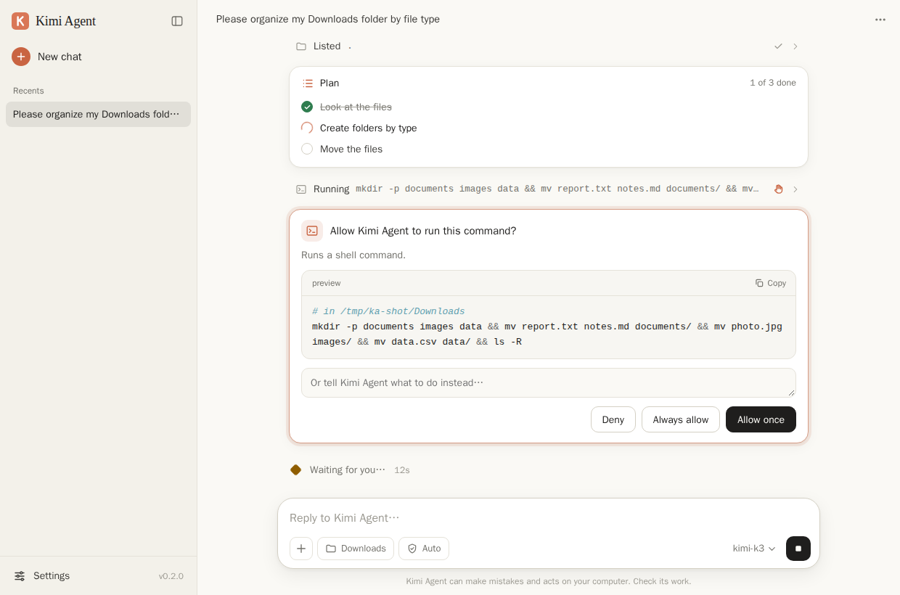

# Kimi Agent

**Turn an open-source model into an autonomous agent that works on your computer.**

Kimi Agent gives agentic capabilities to [Kimi](https://platform.kimi.ai) or to any model behind an
OpenAI-compatible API: Qwen, DeepSeek, GLM, Llama and others, through OpenRouter, Ollama, vLLM, SGLang and
similar servers. Give it a task and it plans, runs shell commands, reads and edits files, runs Python, searches
and reads the web, controls the mouse and keyboard, calls MCP servers and delegates sub-tasks. It keeps going
until the job is done.

Use it as a desktop app modeled on Claude's, as an interactive terminal app, as a one-shot command in scripts and
CI, or as a Python library with your own tools.



> [!WARNING]
> Kimi Agent has **full access to your computer**: it runs commands and changes files with your user's
> permissions. The [approval system](#approvals-and-safety) asks before risky actions, but it is a safety net,
> not a sandbox. Only use `--yolo` inside a container or VM you can throw away.

- [Features](#features)
- [Install](#install)
- [Desktop app](#desktop-app)
- [Quick start](#quick-start)
- [Providers and models](#providers-and-models)
- [Interactive sessions](#interactive-sessions)
- [Scripts, pipes and CI](#scripts-pipes-and-ci)
- [Approvals and safety](#approvals-and-safety)
- [Tools](#tools)
- [Sessions, undo, memory and project instructions](#sessions-undo-memory-and-project-instructions)
- [Computer use](#computer-use)
- [MCP servers](#mcp-servers)
- [Configuration](#configuration)
- [Local models](#local-models)
- [Custom tools and the Python API](#custom-tools-and-the-python-api)
- [How it works](#how-it-works)
- [Development](#development)

## Features

- **Desktop app**: a chat window modeled on Claude's, with live plans, approval cards and attachments. One-line
  installers for Windows, macOS and Linux need no administrator rights and no Python.
- **Agent loop**: streaming answers and thinking, several tool calls per step, automatic retries, a step limit,
  and Ctrl+C to interrupt at any moment.
- **Any OpenAI-compatible model**: 15 provider presets, including Kimi K3 with its 1M-token context and
  adjustable reasoning effort. Models without native tool calling work through a prompt-based text mode.
- **31 built-in tools**: shell commands and background processes; reading, editing and searching files; a
  persistent Python interpreter; web search and fetch; memory; planning; sub-agents; questions to the user;
  and screen, mouse, keyboard and clipboard control.
- **Approvals**: `ask`, `auto` and `yolo` modes, shell command risk analysis, protection for sensitive files,
  and allow and deny lists.
- **Long tasks**: automatic context compaction, saved sessions you can resume, and `/undo` for file changes.
- **MCP client** for stdio, Streamable HTTP and SSE servers.
- **Context in, results out**: attach files, folders, images and PDFs with `@path`; get JSON events with
  `--json`; export conversations as Markdown.
- **Project instructions** from `AGENTS.md` or `KIMI.md`, and persistent memory across sessions.
- **Extensible**: `@tool` functions, plugin files and a Python API.

## Install

Kimi Agent is developed and tested on Linux. The code also handles macOS and Windows (PowerShell), but those
platforms have had less testing.

### One-line install (desktop app)

**Windows:** open PowerShell (Start menu, type "PowerShell") and paste:

```powershell
powershell -ExecutionPolicy Bypass -c "irm https://raw.githubusercontent.com/Trexfly3/kimi-agent/main/install.ps1 | iex"
```

**macOS and Linux:** open a terminal and paste:

```bash
curl -LsSf https://raw.githubusercontent.com/Trexfly3/kimi-agent/main/install.sh | sh
```

The installer sets up [uv](https://docs.astral.sh/uv/), a small tool that installs Python apps. uv downloads Kimi
Agent with its own copy of Python. The installer then adds **Kimi Agent** to the Start menu, the Applications
folder or the applications menu, and to the desktop, and opens it. It needs no administrator rights. It also
installs the `kimi-agent` terminal command.

- **Update:** run the same command again.
- **Uninstall:** on Windows, use Settings > Apps > Installed apps > Kimi Agent > Uninstall. On macOS and Linux,
  run `curl -LsSf https://raw.githubusercontent.com/Trexfly3/kimi-agent/main/install.sh | sh -s -- --uninstall`.
  Your settings and conversations stay in `~/.kimi-agent`; delete that folder to remove them too.

### With pipx or pip

Requires Python 3.10 or newer.

```bash
git clone https://github.com/Trexfly3/kimi-agent.git
cd kimi-agent
pipx install .            # or: pip install .
kimi-agent --install-shortcuts   # optional: add the desktop app to your applications menu and desktop
```

Optional extras, e.g. `pipx install '.[all]'`:

| Extra | Adds |
|---|---|
| `computer` | screen, mouse, keyboard and clipboard control (pyautogui, mss, pillow, pyperclip) |
| `docs` | PDF reading (pypdf) |
| `all` | both of the above |
| `dev` | pytest and ruff, for development |

## Desktop app

The desktop app is a chat window modeled on Claude's:

- A sidebar lists your conversations. Each one can be renamed, exported as Markdown or deleted.
- Answers stream in, and the model's thinking can be expanded.
- Every action the agent takes appears as a row you can open to see its input and output, and its plan updates
  live.
- Before a risky action, an approval card asks you to **Allow once**, **Always allow** or **Deny**, or to tell the
  agent what to do instead.
- The bar under the message box picks the working folder, the permission mode (Ask first, Auto or Full access)
  and the model.
- Add files and images with **+**, by pasting or by dragging them in.

On first start, the app asks for your provider and API key. It saves the key in `~/.kimi-agent/.env`, readable
only by you. Settings has the provider and model, reasoning effort, web access, computer use (screen, mouse and
keyboard), permissions, and a system, light or dark theme.

Open it from its shortcut, or from a terminal:

```bash
kimi-agent --gui     # works in the current folder
kimi-agent-gui       # like the shortcut: starts in your home folder
```

How it works:

- **The window.** Kimi Agent runs a small web server on `127.0.0.1` (port 41753, or a free one if that is taken).
  It shows the server in an app window of Microsoft Edge, Google Chrome, Brave or Chromium, without tabs or an
  address bar. If none of these is installed, it uses your default browser. To use another Chromium-based
  browser, set `KIMI_AGENT_BROWSER` to its path.
- **Access.** Only windows opened through a single-use sign-in link get in, and only when the browser opens the
  link itself (from the shortcut, or pasted into the address bar), not when a web page does. Each window also gets
  a private key, so other web pages on `127.0.0.1` can't use the app even though browsers share cookies between
  local ports. The app answers only at `127.0.0.1`, not `localhost`. It refuses requests from other websites and,
  on Linux, connections from other users' programs.
- **Opening it again.** While the app runs, opening it again opens another window on the same conversation.
- **Quitting.** The app quits by itself two minutes after its last window closes. If a task is still running, it
  waits for the task to finish, for up to 30 minutes. `kimi-agent --quit-gui` closes it at once. With
  `--no-browser`, it runs until you press Ctrl+C.
- **Logs** are in `~/.kimi-agent/logs`.

| Option | |
|---|---|
| `--gui` | open the desktop app |
| `--no-browser` | print a sign-in link instead of opening a window |
| `--port N` | port of the local server |
| `--install-shortcuts`, `--remove-shortcuts` | add or remove the Start menu or Applications entry and the desktop shortcut |
| `--quit-gui` | close the running desktop app |

## Quick start

Get an API key from the [Kimi platform](https://platform.kimi.ai), then:

```bash
export KIMI_API_KEY=sk-...     # MOONSHOT_API_KEY works too, or put it in ~/.kimi-agent/.env

kimi-agent                                           # interactive session in the current directory
kimi-agent "find out why the tests fail and fix it"  # one-shot task
git diff | kimi-agent "write a commit message"       # piped input
kimi-agent -c                                        # continue the last session in this directory
kimi-agent -p openrouter                             # another provider (needs OPENROUTER_API_KEY)
kimi-agent -p ollama -m qwen3:8b                     # fully local, no key needed
```

The agent works in the current directory (use `-C DIR` to choose another). By default it runs in `auto`
approval mode: on its own it reads and searches anything, edits files inside the working directory and runs
read-only commands. It asks before doing anything else.

`kimi-agent --init-config` writes a commented `~/.kimi-agent/config.toml`. [`.env.example`](.env.example) lists
the supported environment variables.

## Providers and models

| Provider | Default model | API key variable |
|---|---|---|
| `kimi` (default) | `kimi-k3` | `KIMI_API_KEY` or `MOONSHOT_API_KEY` |
| `kimi-cn` | `kimi-k3` on api.moonshot.cn (mainland China) | `KIMI_API_KEY` or `MOONSHOT_API_KEY` |
| `kimi-code` | `kimi-for-coding` (Kimi Code subscription) | `KIMI_CODE_API_KEY` or `KIMI_API_KEY` |
| `openrouter` | `moonshotai/kimi-k3` | `OPENROUTER_API_KEY` |
| `huggingface` | `moonshotai/Kimi-K2-Instruct-0905` | `HF_TOKEN` |
| `groq` | `moonshotai/kimi-k2-instruct-0905` | `GROQ_API_KEY` |
| `together` | `moonshotai/Kimi-K2-Instruct-0905` | `TOGETHER_API_KEY` |
| `fireworks` | `accounts/fireworks/models/kimi-k2-instruct-0905` | `FIREWORKS_API_KEY` |
| `deepseek` | `deepseek-chat` | `DEEPSEEK_API_KEY` |
| `ollama` | `qwen3:8b` on localhost:11434 | none |
| `vllm` | `moonshotai/Kimi-K3` on localhost:8000 | `VLLM_API_KEY` (optional) |
| `sglang` | `moonshotai/Kimi-K3` on localhost:30000 | none |
| `lmstudio` | `local-model` on localhost:1234 | none |
| `llamacpp` | `local-model` on localhost:8080 | none |
| `custom` | set with `--base-url` and `-m` | `OPENAI_API_KEY` (optional) |

`kimi-agent --list-providers` also shows the URLs and context window sizes.

- Choose with `-p NAME` and `-m MODEL`, with the `provider` and `model` settings, or with `/provider` and
  `/model` during a session. `/models` lists the models the server offers.
- For any other OpenAI-compatible server use `kimi-agent --base-url https://host/v1 -m MODEL`, or add a named
  provider to `config.toml`:

  ```toml
  [providers.my-server]
  base_url = "http://192.168.1.20:8000/v1"
  model = "moonshotai/Kimi-K3"
  api_key_env = "MY_SERVER_KEY"
  context_window = 131072
  ```

**Kimi K3**, the default model, has a 1M-token context window, understands images and always thinks before it
answers. `--reasoning-effort low|high|max` (or `/effort` in a session) trades depth for speed, and
`--show-reasoning` (or `/reasoning on`) displays the thinking. K3 uses fixed sampling settings, so if the API
rejects `temperature` or `top_p`, Kimi Agent stops sending them.

The Hugging Face, Groq, Together and Fireworks presets default to Kimi K2 models. If a host no longer serves
them, pick another model with `-m`.

## Interactive sessions

Run `kimi-agent` with no prompt, or `kimi-agent -i "first task"` to stay in the session after the first task.

| Key | Action |
|---|---|
| Enter | send |
| Esc then Enter, Ctrl+J, or a trailing `\` | new line |
| Ctrl+X Ctrl+E | write the message in `$EDITOR` |
| Up / Down, Tab | history; completion of commands and `@` paths |
| Ctrl+C | interrupt the agent, or clear the line (press it twice on an empty line to exit) |
| Ctrl+D or `/exit` | save and quit |

- `@path` attaches a file, a folder listing, an image or a PDF to your message: `explain @src/main.py`.
- `!command` runs a shell command yourself and sends its output with your next message: `!pytest -x`.

| Command | Description |
|---|---|
| `/help` | commands and shortcuts |
| `/new` | start a new conversation (the current one is saved) |
| `/sessions`, `/resume [id]` | list and resume saved sessions |
| `/undo` | remove the last request and revert its file changes |
| `/retry` | undo the last request and run it again |
| `/compact [focus]` | summarize the conversation to free context |
| `/export [file]`, `/copy` | save the conversation as Markdown; copy the last answer |
| `/init` | analyze the project and write an `AGENTS.md` for future sessions |
| `/plan`, `/tokens`, `/system`, `/tools`, `/config` | show the plan, token usage, system prompt, tools or settings |
| `/model [name]`, `/models`, `/provider [name [model]]` | show or switch the model and provider |
| `/effort [level]` | reasoning effort: `low`, `medium`, `high`, `max` or `off` |
| `/reasoning [on/off]` | show or hide the model's thinking |
| `/approval [mode]` | approval mode: `ask`, `auto` or `yolo` |
| `/mcp [reload]` | show MCP servers, or restart them |
| `/ps [stop ID]` | list background processes, or stop one |
| `/memory [add TEXT, forget TEXT, clear]` | show or edit persistent memory |
| `/cd [dir]` | show or change the working directory |

## Scripts, pipes and CI

Given a prompt, Kimi Agent runs the task to completion, prints the final answer and exits.

```bash
kimi-agent "update CHANGELOG.md for the 2.1 release"
kimi-agent -q "summarize README.md" > summary.txt      # -q: print only the final answer
cat build.log | kimi-agent "why did the build fail?"   # piped text is added to the prompt
kimi-agent -c "now add tests for it"                   # continue the last session in this directory
kimi-agent --json "run the tests" > events.jsonl       # machine-readable events
```

- When stdout is not a terminal, progress goes to stderr and only the answer goes to stdout.
- **Approvals without a terminal.** When stdin is not a terminal (pipes, CI) or `--json` is used, nobody can
  answer approval prompts. Actions that need approval are refused and the model is told why, so decide up
  front what may run: `auto` mode (the default) with `allow_commands`, or `--yolo` inside a sandbox.
- If the calling program keeps stdin open without writing to it (some CI runners, `ssh host cmd`), Kimi Agent
  waits for that input. Add `< /dev/null`.
- Exit codes: `0` success, `1` model or API error, `2` usage or configuration error (for example a missing API
  key), `130` interrupted.

`--json` prints one JSON object per line:

```json
{"type": "assistant", "content": "I'll run the tests first."}
{"type": "tool_call", "name": "run_command", "arguments": {"command": "pytest -q"}}
{"type": "tool_result", "name": "run_command", "output": "3 passed in 0.12s\n[exit code: 0]", "is_error": false, "images": 0, "seconds": 0.9}
{"type": "final", "content": "All 3 tests pass.", "usage": {"prompt_tokens": 5120, "completion_tokens": 230, "cached_tokens": 0, "reasoning_tokens": 96}, "session": "20260801-142233-a1b2c3"}
```

The other event types are `plan`, `info`, `warning` and `error`. If the run fails, the `final` event has an
`error` field instead of `content`.

## Approvals and safety

Before each tool call, an approval policy decides whether to run it, ask you, or refuse. When it asks, answer
`y` (Enter also approves low-risk actions) or `n`. You can also answer `a` to always allow that kind of action
for the rest of the session (for example, all `npm install` commands), or type instructions: the action is
refused and the model receives your words.

| Action | `ask` | `auto` (default) | `yolo` |
|---|---|---|---|
| Read and search files, plan, memory, screenshots | runs | runs | runs |
| Web search and fetch | asks | runs | runs |
| Write and edit files inside the working directory | asks | runs | runs |
| Write files elsewhere, delete files | asks | asks | runs |
| Read-only commands (`ls`, `cat`, `grep`, `git status`, `git diff`...) | asks | runs | runs |
| Other commands, Python code, background processes | asks | asks | runs |
| Mouse, keyboard and clipboard | asks | asks | runs |
| MCP tools (servers with `trust = true` always run) | asks | asks, unless marked read-only | runs |
| Dangerous commands | asks | asks | runs |
| Catastrophic commands | asks | asks | **asks** |

- **Dangerous** commands include `sudo`, `rm -r`, `git push --force`, `git reset --hard`, `curl ... | sh`,
  `kill`, `docker rm`, `kubectl delete`, `terraform apply`, `DROP TABLE` and package publishing. Approving one
  takes an explicit `y`; Enter is not enough.
- **Catastrophic** commands (`rm -rf /` or `~`, `mkfs`, `dd` onto a disk, fork bombs...) ask even in `yolo`
  mode.
- The analysis looks inside pipelines, `&&` and `;` chains and `bash -c` scripts, and sees through wrappers
  such as `sudo`, `env`, `timeout` and `xargs`.
- Writes to sensitive places such as `~/.ssh`, `~/.aws`, shell startup files, system directories, `.git`
  directories and Kimi Agent's own configuration always ask in `ask` and `auto` mode, even for tools you chose
  to always allow.
- `auto` mode never approves writes on its own when the working directory is your home directory or `/`.
- Fixed rules go in `config.toml`:

  ```toml
  allow_commands = ["pytest", "npm run", "cargo test"]  # prefixes that run without asking (unless dangerous)
  deny_commands = ['\bgit\s+push\b']                    # regular expressions that are always refused
  ```

- Choose the mode with `-a ask|auto|yolo`, `-y` (yolo), the `approval` setting, or `/approval` in a session.

These rules guard against mistakes; they are not a security boundary, because a model can do damage with
commands that look harmless. Keep your work in git and run untrusted tasks in a container or VM.

## Tools

| Tool | What it does |
|---|---|
| `read_file` | read text files with line numbers, images (for vision models) and PDFs |
| `write_file`, `edit_file` | create or overwrite a file; replace an exact piece of text |
| `list_directory`, `find_files`, `search_files` | directory tree; find files by glob; search contents by regex |
| `delete_path` | delete a file or directory |
| `run_command` | run a shell command (bash, or PowerShell on Windows) with a timeout |
| `start_process`, `process_output`, `process_input`, `stop_process`, `list_processes` | background processes such as dev servers and watchers |
| `run_python` | run code in a persistent Python interpreter, like a notebook |
| `web_search`, `web_fetch` | search the web; fetch a page as Markdown (also JSON and PDFs) |
| `remember`, `forget` | persistent memory |
| `update_plan` | keep a visible checklist for multi-step work |
| `ask_user` | ask you a question (interactive sessions only) |
| `delegate_task` | hand a self-contained sub-task to a sub-agent |
| `screenshot`, `mouse_click`, `mouse_move`, `mouse_drag`, `scroll`, `type_text`, `press_keys`, `clipboard_read`, `clipboard_write`, `open_target` | computer use (see below) |

- Web search uses Tavily, Brave or a SearXNG instance when `TAVILY_API_KEY`, `BRAVE_API_KEY` or `SEARXNG_URL`
  is set, and DuckDuckGo otherwise. Set `search_backend` to force one. With the official Kimi API,
  `kimi_web_search = true` uses Kimi's built-in server-side search instead.
- Turn tools off with `disabled_tools = ["delete_path", "mcp__github__*"]` (glob patterns), `--no-web`,
  `--no-memory` or `subagents = false`.
- Long tool output is cut in the middle to `max_output_chars` (30,000 by default) before the model sees it.

## Sessions, undo, memory and project instructions

- **Sessions.** Every conversation is saved in `~/.kimi-agent/sessions/`. Use `-c` to continue the latest
  session for the current directory, `-r ID` to resume a specific one (a prefix of the ID is enough), and
  `--list-sessions`, `/sessions` or `/resume` to find them.
- **Undo.** `/undo` removes your last request from the conversation and reverts the changes the file tools
  made during it (`write_file`, `edit_file` and deleted files). It cannot undo what shell commands or Python
  code did, so keep your work in git.
- **Memory.** The agent saves lasting facts, such as your preferences and project conventions, with the
  `remember` tool. They go to `~/.kimi-agent/memory.md` and are shown to the agent in every session. Manage them
  with `/memory`, or turn memory off with `--no-memory`.
- **Project instructions.** `AGENTS.md` and `KIMI.md` files are added to the system prompt: a global one from
  `~/.kimi-agent/`, plus those in every directory from the git root down to the working directory. `/init`
  writes one for the current project.
- **Context.** When the conversation fills `compact_threshold` (80% by default) of the context window, older
  messages are summarized automatically. `/compact [focus]` does it on demand.
- **Plans and sub-agents.** For multi-step work the agent keeps a checklist (`update_plan`, shown with
  `/plan`). It can hand self-contained sub-tasks, such as researching a large codebase, to sub-agents with
  `delegate_task`. A sub-agent starts with a fresh context window, has the same tools and permissions, and
  reports back when it is done.

## Computer use

```bash
pipx install '.[computer]'      # or: pip install '.[computer]'
kimi-agent --computer "open the browser and find tomorrow's weather in Paris"
```

- Turn it on with `--computer` or `computer_use = true`. The agent sees the screen through screenshots and acts
  with `mouse_click`, `mouse_move`, `mouse_drag`, `scroll`, `type_text`, `press_keys`, the clipboard tools and
  `open_target`, which opens a URL, file or folder in its default application.
- It needs a model that understands images. Kimi K3 does; for other models set `vision = true`. A fresh
  screenshot is sent after each action (`computer_auto_screenshot`).
- Linux needs an X11 display (`DISPLAY`). XWayland works; pure Wayland sessions don't. On macOS, give your
  terminal app the Accessibility and Screen Recording permissions.
- Mouse, keyboard and clipboard actions ask for approval unless you use `yolo` mode. To stop the agent, press
  Ctrl+C or push the mouse into a corner of the screen (the PyAutoGUI fail-safe).
- For web tasks, a browser MCP server such as Playwright is usually faster and more reliable than clicking on
  pixels.

## MCP servers

Add [Model Context Protocol](https://modelcontextprotocol.io) servers to `config.toml`. They start in
parallel when a session starts.

```toml
[mcp_servers.playwright]              # local server: a command that speaks MCP over stdio
command = "npx"
args = ["-y", "@playwright/mcp@latest"]

[mcp_servers.github]                  # remote server over Streamable HTTP
url = "https://api.githubcopilot.com/mcp/"
headers = { Authorization = "Bearer ${GITHUB_TOKEN}" }
tools = ["get_file_contents", "search_code"]   # expose only these tools

[mcp_servers.docs]
url = "https://mcp.context7.com/mcp"
trust = true                          # run its tools without asking
```

| Key | Meaning |
|---|---|
| `command`, `args`, `env`, `cwd` | start a local server that talks over stdio |
| `url`, `headers` | connect to a remote server; URLs ending in `/sse` use the older SSE transport |
| `transport` | force `stdio`, `http` or `sse` |
| `trust` | `true` runs the server's tools without approval |
| `tools` | allowlist of the tools to expose |
| `enabled` | `false` keeps a server configured but turned off |
| `startup_timeout`, `timeout` | seconds to wait for the server to start (60) and for each call (300) |

- `${VAR}` and `${VAR:-default}` are replaced with environment variables, so secrets can stay out of the file.
- The model sees MCP tools as `mcp__<server>__<tool>`. Hide some with `disabled_tools`, e.g.
  `["mcp__github__*"]`.
- `/mcp` shows each server's state and tool count, and `/mcp reload` restarts the servers after you edit the
  configuration. When a server announces that its tool list changed, the change is picked up automatically.
  `--no-mcp` skips MCP servers for one run.

## Configuration

Settings come from these sources, highest priority first:

1. command-line options;
2. environment variables named `KIMI_AGENT_<SETTING>`, e.g. `KIMI_AGENT_MODEL=kimi-k3` (lists are
   comma-separated or JSON; empty values are ignored);
3. the file given with `--config FILE`, e.g. a per-project configuration;
4. `~/.kimi-agent/config.toml`;
5. the provider preset and built-in defaults.

`.env` files in the working directory and in `~/.kimi-agent/` are loaded as well, without overriding variables
that are already set. `kimi-agent --init-config` writes a commented template, and `/config` shows the effective
settings and file locations.

| Setting | Default | Purpose |
|---|---|---|
| `provider`, `model`, `base_url`, `api_key` | `kimi` and its preset | which model to use |
| `approval` | `auto` | `ask`, `auto` or `yolo` |
| `allow_commands`, `deny_commands` | none | see [Approvals and safety](#approvals-and-safety) |
| `reasoning_effort` | model default | e.g. `low`, `high`, `max` |
| `max_tokens`, `temperature`, `top_p` | model default | output limit per response; sampling |
| `context_window`, `compact_threshold` | from the preset; `0.8` | when to compact the conversation |
| `tool_mode` | `auto` | `native`, or `text` for prompt-based tool calls |
| `vision` | from the preset | send images to the model |
| `web`, `search_backend`, `kimi_web_search` | `true`, `auto`, `false` | web tools |
| `computer_use` | `false` | screen, mouse and keyboard control |
| `memory`, `subagents` | `true`, `true` | persistent memory; `delegate_task` |
| `disabled_tools`, `plugins` | none | turn tools off; load custom tools |
| `max_steps` | `100` | tool-calling steps per request; then you are asked whether to continue (unattended runs wrap up) |
| `command_timeout`, `max_output_chars` | `300`, `30000` | shell command timeout in seconds; tool output limit |
| `shell`, `python` | `$SHELL`; the running interpreter | used by `run_command` and `run_python` |
| `extra_body`, `extra_headers` | none | extra request parameters and HTTP headers |
| `mcp_servers`, `providers` | none | [MCP servers](#mcp-servers); [custom providers](#providers-and-models) |

Everything lives in `~/.kimi-agent/`, or in `$KIMI_AGENT_HOME` if that is set:

```text
~/.kimi-agent/
├── config.toml   settings
├── .env          API keys
├── AGENTS.md     instructions for every project (optional)
├── memory.md     persistent memory
├── sessions/     saved conversations
└── logs/         kimi-agent.log (more detail with --debug; API keys are never logged)
```

## Local models

With [Ollama](https://ollama.com):

```bash
ollama pull qwen3:8b
OLLAMA_CONTEXT_LENGTH=32768 ollama serve
kimi-agent -p ollama -m qwen3:8b        # or: kimi-agent --config examples/local-ollama.toml
```

- Ollama's default context window is small, and Ollama silently drops the start of longer conversations,
  including the system prompt and the tool definitions. Set `OLLAMA_CONTEXT_LENGTH`, and set the same value as
  `context_window` in Kimi Agent.
- vLLM and SGLang: start the server with tool calling enabled (for vLLM: `--enable-auto-tool-choice
  --tool-call-parser <the parser for your model>`), then run `kimi-agent -p vllm -m <served model name>`.
- Models or servers without native tool calling: with `--tool-mode text` the model writes its tool calls as
  `<tool_call>` JSON blocks in its answer. In the default `auto` mode, Kimi Agent switches to text mode by
  itself when a server rejects tool definitions.
- Agent work needs a capable model. Small models follow multi-step tool use far less reliably, so use the
  largest model your hardware can run.

## Custom tools and the Python API

### Write a tool

```python
# ~/.kimi-agent/plugins/my_tools.py
from kimi_agent import tool

@tool
def word_count(text: str) -> int:
    """Count the words in a text.

    Args:
        text: The text to count.
    """
    return len(text.split())
```

Load it in `config.toml`, or for a single run with `KIMI_AGENT_PLUGINS=path/to/my_tools.py kimi-agent ...`:

```toml
plugins = ["~/.kimi-agent/plugins/my_tools.py"]
```

Plugins are Python files (absolute paths, or paths relative to the working directory or `~/.kimi-agent`) or
importable module names. A plugin exposes all of its module-level tools, or only those listed in
`TOOLS = [...]`. A tool whose name is already taken is skipped with a warning.

- The function name becomes the tool name, the docstring its description, and the `Args:` section describes the
  parameters. Type hints (`str`, `int`, `float`, `bool`, lists, dicts, `Literal[...]`, `TypedDict`, optional
  values) become the JSON schema; parameters with defaults are optional.
- To use the session, make the first parameter `ctx` (a `ToolContext`). `ctx.resolve(path)` resolves paths
  against the working directory; `ctx.cwd`, `ctx.settings` and `ctx.state` (a dict for your own data) are
  available too. Calling `ctx.file_history.record(path)` before changing a file makes `/undo` work.
- Return a string, any JSON-serializable value, or a `ToolResult`, which can carry images. Raise
  `ToolError("message")` to report a failure to the model.
- `@tool(name=..., category=...)` sets the name and the category. The category decides when approval is needed:

| Category | Approval |
|---|---|
| `read` (the default), `internal` | never asks |
| `network` | asks in `ask` mode |
| `write` | like file edits: in `auto` mode it runs without asking if its `path` argument (or, without one, the working directory) is inside the project |
| `execute`, `gui` | asks unless the mode is `yolo` |

> [!IMPORTANT]
> The default category, `read`, never asks for approval. Give every tool that changes something, runs code or
> contacts another system the right category.

[`examples/plugin_project_stats.py`](examples/plugin_project_stats.py) is a complete plugin with a read-only tool
and an undoable write tool.

### Python API

```python
import kimi_agent

answer = kimi_agent.run("List the TODO comments in this repository", workdir="/path/to/repo")
print(answer)
```

`kimi_agent.run(task, **options)` runs one task and returns the final answer. `create_runtime(**options)`
returns a started runtime for multi-turn conversations. Use it as a context manager so the session is saved and
background processes and MCP servers are stopped at the end:

```python
from kimi_agent import create_runtime, tool

@tool
def order_status(order_id: str) -> str:
    """Look up the status of an order in the shop database."""
    return f"Order {order_id}: shipped on 2026-07-30"

with create_runtime(tools=[order_status], provider="openrouter") as runtime:
    print(runtime.agent.run("Where is order 1234?"))
    print(runtime.agent.run("Write a two-line email telling the customer."))
    print(runtime.agent.usage.total_tokens, "tokens")
```

- Options are any setting (`provider`, `model`, `approval`, `workdir`, `computer_use`...) plus `tools`,
  `config_file`, `use_mcp`, `ui` and `interactive`. Configuration files and environment variables apply as
  usual.
- By default nothing is printed and `interactive=False`: as in CI, actions that need approval are refused. For
  terminal output and approval prompts, pass `ui=UI(), interactive=True` (`from kimi_agent.ui import UI`), or
  decide up front with `approval` and `allow_commands`.

See [`examples/python_api.py`](examples/python_api.py).

## How it works

```text
cli.py, repl.py, api.py   entry points: one-shot runs, the interactive session, the Python API
runtime.py                builds a session from the settings: model client, tools, approval policy, MCP, plugins
agent.py                  the loop: model -> tool calls -> approval -> execution -> results -> model ... -> answer
llm.py                    OpenAI-compatible client: streaming, retries, Kimi specifics, text-mode tool calls
context.py                token estimates and conversation compaction
safety.py                 approval policy and shell command risk analysis
tools/                    built-in tools: files, shell, Python, web, memory, interaction, computer use
mcp.py                    MCP client (stdio, Streamable HTTP, SSE)
prompts.py                system prompt and AGENTS.md loading
session.py, plugins.py    saved conversations; custom tool loading
config.py, ui.py          settings and provider presets; terminal and JSON output
gui/                      desktop app: local server, API and event stream (server.py, app.py, webui.py), window
                          launcher and shortcuts (launcher.py, shortcuts.py), Markdown (render.py), web page (static/)
install.sh, install.ps1   one-line installers (uv, Kimi Agent, shortcuts; update and uninstall)
```

At each step the agent sends the conversation and the tool definitions to the model and streams its reply. Each
tool call in the reply goes through the approval policy and runs, and its result (text and images) is added to
the conversation. This repeats until the model answers without calling a tool. Tool errors go back to the model
so it can recover, long outputs are truncated, and the history is compacted as it nears the context limit.

## Development

```bash
python -m venv .venv && . .venv/bin/activate
pip install -e '.[dev]'
pytest           # uses a local fake OpenAI server: no API key or network needed
ruff check .
```

`scripts/make_icons.py` regenerates the app icons in `kimi_agent/gui/static/`. It needs Pillow:
`uv run --no-project --with pillow python scripts/make_icons.py`. To try the installers on a branch, set
`KIMI_AGENT_REF=<branch>` (or `KIMI_AGENT_SOURCE` to a zip URL) before running them.
